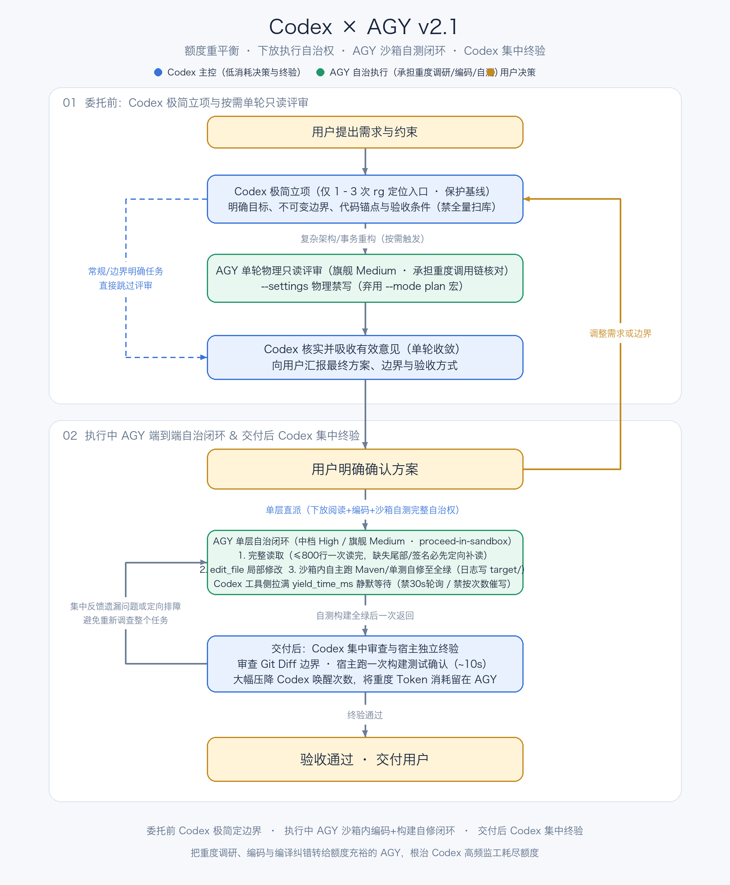

# Codex AGY

用额度充裕的 AGY（Gemini）分担代码调研、实现与自测闭环，节省主控 Codex 的额度。

将 [AGENTS.md](AGENTS.md) 中的分工合并到目标项目的 `AGENTS.md`。确认 `agy` 已安装并在 `~/.gemini/antigravity-cli/settings.json` 中开启全局完整权限（`"toolPermission": "always-proceed"`, `"allowNonWorkspaceAccess": true`, `"enableTerminalSandbox": false"`），然后在本仓库根目录安装包装器与 Skill：

```bash
mkdir -p ~/.local/bin ~/.codex/skills/codex-agy
cp bin/agy-delegate ~/.local/bin/agy-delegate
chmod +x ~/.local/bin/agy-delegate
cp codex-agy/SKILL.md ~/.codex/skills/codex-agy/SKILL.md
```

在目标项目的 Codex 对话中按需调用 `$codex-agy`。
- [SKILL.md](codex-agy/SKILL.md)：调用规范、V8 零唤醒等待模板与 `agy-delegate` 用法。
- [bin/agy-delegate](bin/agy-delegate)：自动匹配项目 ID、自动打脏工作区快照、一键无损还原与 JSON 软拒绝校验包装器。
- [CHANGELOG.md](CHANGELOG.md)：问题排查复盘与版本演进记录。

## 架构与执行流程



[查看完整尺寸 PNG](assets/architecture.png)

### 协作四原则

1. **委托前**：Codex 讲清楚**业务目标、必要设计、不可变边界和验收条件**，不对 AGY 做过度限制或手把手指导；`agy-delegate` 自动完成项目匹配与脏工作区快照。
2. **执行中**：单层直派 AGY 会话，由 AGY 自主完成阅读、编码、运行测试与局部纠错；Codex 在 `exec` V8 沙箱内用 `while` 循环阻塞等完（最长 5 分钟零模型唤醒），不轮询、不按读取次数和耗时催写。
3. **交付后**：`agy-delegate` 自动校验返回 JSON 与 `denied_actions`；Codex 集中审查 `git diff`、执行独立验证，把实际问题一次性交回 AGY。
4. **出现阻塞或需回滚时**：针对具体阻塞定向处理，Codex 绝不亲自下场改业务代码；若需回滚直接调用 `agy-delegate restore <snapshot_dir>`。
