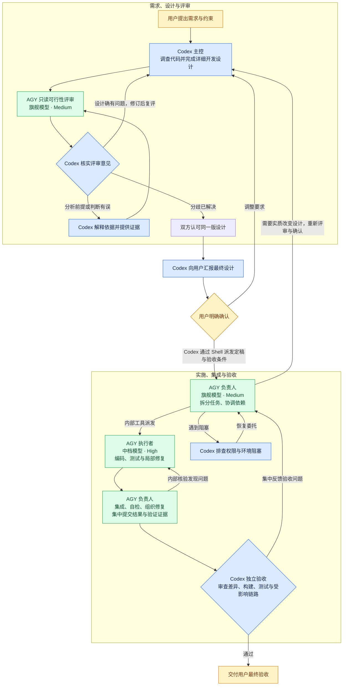

# Codex AGY

Codex 决定技术方案并独立验收。AGY 通过原生 CLI 提供可行性反馈，并在授权范围内实现和测试。

将 [AGENTS.md](AGENTS.md) 中的分工合并到目标项目的 `AGENTS.md`。确认 `agy` 已安装并登录，然后在本仓库根目录安装 Skill。

```bash
mkdir -p ~/.codex/skills/codex-agy
cp codex-agy/SKILL.md ~/.codex/skills/codex-agy/SKILL.md
```

从旧版升级时，可从个人 Skill 目录中移除旧版的 `scripts/run_agy.py`、`references/protocol.md`、`references/result.schema.json` 和 `agents/openai.yaml`。

在目标项目的 Codex 对话中按需调用 `$codex-agy`。[SKILL.md](codex-agy/SKILL.md) 提供原生命令、会话续接和权限配置说明。

## 架构与执行流程



Codex 实际执行 AGY CLI 调用。AGY 负责人按已确认设计组织实现，生产代码、测试代码与实现配置由 AGY 执行者修改。定稿设计、Git 差异及验证日志作为交接和验收依据。设计评审续接原会话，确认后新开负责人实施会话，同一交付单元的返工优先续接。

内部子 Agent 的模型和推理档位配置、headless 调用能力须在正式派发前验证。并行写任务使用已授权的隔离工作树，或先核实文件修改范围互不重叠。共享契约和集成修改按依赖顺序执行。
